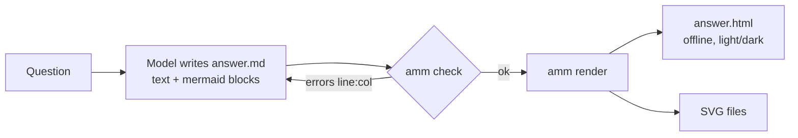

# answer-me-with-mermaid

[English](README.md) | [简体中文](README.zh-CN.md)

An agent skill that makes your AI **answer with diagrams**. The model writes a short
answer plus **standard Mermaid**; a bundled CLI built on [Pele](https://pele.run)
validates it, reports `line:column` errors so the model can fix and retry, and renders
SVG plus a **single-file, offline HTML** page with light/dark themes.

## Why

- **The model only writes Mermaid.** No hand-written SVG/HTML, fewer tokens, fewer bugs.
- **Portable output.** The Mermaid blocks stay in the answer, so they also render on
  GitHub, Obsidian, and other Mermaid-aware tools.
- **Fast, offline, no browser.** Pele renders Mermaid to SVG synchronously in Node, with
  no runtime dependencies.
- **Self-correcting.** Precise errors (`answer.md:14:7 [code] message` + snippet) let the
  model fix its own diagrams — at most 2 retries, then it falls back to text.

## How it works



## Usage

```bash
node skills/answer-me-with-mermaid/scripts/amm.mjs check  answer.md
node skills/answer-me-with-mermaid/scripts/amm.mjs render answer.md -o answer.html [--theme light|dark|auto]
```

Theming uses Pele's `--pele-*` CSS variables. See [INSTALL.md](INSTALL.md) to install the skill.

## Layout

```
skills/answer-me-with-mermaid/
  SKILL.md            # instructions for the model
  scripts/amm.mjs     # bundled CLI (built by `npm run build`, includes Pele)
src/cli.js            # CLI source
examples/             # sample answers
test/                 # tests
```

## Status

Early scaffold (v0.1.0). Known caveat: Pele has its own layout and visual style, so a
diagram that validates here may look slightly different on GitHub's Mermaid renderer.

## Credits

- **Inspired by and design adapted from
  [QingYunA/answer-me-with-html](https://github.com/QingYunA/answer-me-with-html)** (MIT) —
  the idea of an agent skill where the model writes a simple source format and a bundled
  CLI validates and renders it offline. No code or prompt text is copied. Its notice:

  > Copyright (c) 2026 Answer me with HTML contributors
  >
  > Permission is hereby granted, free of charge, to any person obtaining a copy
  > of this software and associated documentation files (the "Software"), to deal
  > in the Software without restriction, including without limitation the rights
  > to use, copy, modify, merge, publish, distribute, sublicense, and/or sell
  > copies of the Software, and to permit persons to whom the Software is
  > furnished to do so, subject to the following conditions:
  >
  > The above copyright notice and this permission notice shall be included in all
  > copies or substantial portions of the Software.
  >
  > THE SOFTWARE IS PROVIDED "AS IS", WITHOUT WARRANTY OF ANY KIND, EXPRESS OR
  > IMPLIED, INCLUDING BUT NOT LIMITED TO THE WARRANTIES OF MERCHANTABILITY,
  > FITNESS FOR A PARTICULAR PURPOSE AND NONINFRINGEMENT. IN NO EVENT SHALL THE
  > AUTHORS OR COPYRIGHT HOLDERS BE LIABLE FOR ANY CLAIM, DAMAGES OR OTHER
  > LIABILITY, WHETHER IN AN ACTION OF CONTRACT, TORT OR OTHERWISE, ARISING FROM,
  > OUT OF OR IN CONNECTION WITH THE SOFTWARE OR THE USE OR OTHER DEALINGS IN THE
  > SOFTWARE.

- **Rendering by [Pele](https://github.com/obsidianmd/pele)** (https://pele.run, MIT,
  Copyright (c) 2026 kepano) — a fast, lightweight Mermaid → SVG renderer by Obsidian.
  The bundled `amm.mjs` includes Pele.

Full license texts: [THIRD_PARTY_NOTICES.md](THIRD_PARTY_NOTICES.md).

## License

[MIT](LICENSE) © 2026 answer-me-with-mermaid contributors
