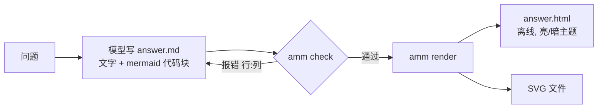

# answer-me-with-mermaid

[English](README.md) | [简体中文](README.zh-CN.md)

一个让 AI **用图来回答**的 agent skill。模型只写一段简短的文字回答，加上**标准 Mermaid**；
内置的 CLI 基于 [Ondine](https://github.com/wevm/ondine)（用 Rust 写的 Mermaid 编译器，以 WebAssembly 运行）做校验，出错时返回 `行:列`，让模型修改后重试；
通过后渲染成 SVG 和一个**离线单文件 HTML**，支持亮色/暗色主题。

## 为什么

- **模型只写 Mermaid。** 不手写 SVG/HTML，更省 token，出错更少。
- **输出可移植。** 回答里保留 mermaid 代码块，在 GitHub、Obsidian 等支持 Mermaid 的地方也能直接显示。
- **快、离线、不需要浏览器。** Ondine 在 Node 里同步把 Mermaid 编译成 SVG，不需要 DOM（一般回答里的图每张不到 1 毫秒）。
- **能自我纠错。** 精确的错误信息（`answer.md:14:7 [code] message` 加出错片段）让模型自己修图；最多重试 2 次，之后退回纯文字。

## 工作流程



## 用法

clone 之后先构建一次（需要 Node 20+），在 `amm.mjs` 旁边生成 `ondine.wasm`（这个文件不提交到仓库）：

```bash
npm install && npm run build
```

```bash
node skills/answer-me-with-mermaid/scripts/amm.mjs check  answer.md
node skills/answer-me-with-mermaid/scripts/amm.mjs render answer.md -o answer.html [--theme light|dark|auto]
```

主题通过 Ondine 的 `--ondine-*` CSS 变量控制。安装方法见 [INSTALL.md](INSTALL.md)。

## 目录结构

```
skills/answer-me-with-mermaid/
  SKILL.md            # 写给模型的说明
  scripts/amm.mjs     # 打包后的 CLI（由 `npm run build` 生成，内含 Ondine 的 JS）
  scripts/ondine.wasm # Ondine 的 WebAssembly 编译器（由 `npm run build` 生成，不提交）
src/cli.js            # CLI 源码
examples/             # 示例回答
test/                 # 测试
```

## 状态

早期脚手架（v0.1.0）。已知差异：Ondine 还很新（0.0.x），有自己的单色排版和视觉风格，
在这里校验通过的图，在 GitHub 的 Mermaid 渲染器上看起来可能不同。

## 致谢

- **灵感与设计参考自
  [QingYunA/answer-me-with-html](https://github.com/QingYunA/answer-me-with-html)**（MIT）——
  即"模型写简单的源格式，由内置 CLI 离线校验并渲染"的 agent skill 思路。未复制其代码或提示词原文。其许可声明（原文）：

  > Copyright (c) 2026 Answer me with HTML contributors
  >
  > Permission is hereby granted, free of charge, to any person obtaining a copy
  > of this software and associated documentation files (the "Software"), to deal
  > in the Software without restriction, including without limitation the rights
  > to use, copy, modify, merge, publish, distribute, sublicense, and/or sell
  > copies of the Software, and to permit persons to whom the Software is
  > furnished to do so, subject to the following conditions:
  >
  > The above copyright notice and this permission notice shall be included in all
  > copies or substantial portions of the Software.
  >
  > THE SOFTWARE IS PROVIDED "AS IS", WITHOUT WARRANTY OF ANY KIND, EXPRESS OR
  > IMPLIED, INCLUDING BUT NOT LIMITED TO THE WARRANTIES OF MERCHANTABILITY,
  > FITNESS FOR A PARTICULAR PURPOSE AND NONINFRINGEMENT. IN NO EVENT SHALL THE
  > AUTHORS OR COPYRIGHT HOLDERS BE LIABLE FOR ANY CLAIM, DAMAGES OR OTHER
  > LIABILITY, WHETHER IN AN ACTION OF CONTRACT, TORT OR OTHERWISE, ARISING FROM,
  > OUT OF OR IN CONNECTION WITH THE SOFTWARE OR THE USE OR OTHER DEALINGS IN THE
  > SOFTWARE.

- **渲染由 [Ondine](https://github.com/wevm/ondine) 提供**，作者 [wevm](https://github.com/wevm)
  （https://ondine.sh，MIT，"Copyright (c) 2025-present"）——用 Rust 编译的 Mermaid 图表。
  打包后的 `amm.mjs` 内含 Ondine 的 JS，`ondine.wasm` 是 Ondine 的编译器。

完整许可文本见 [THIRD_PARTY_NOTICES.md](THIRD_PARTY_NOTICES.md)。

## 许可证

[MIT](LICENSE) © 2026 answer-me-with-mermaid contributors
