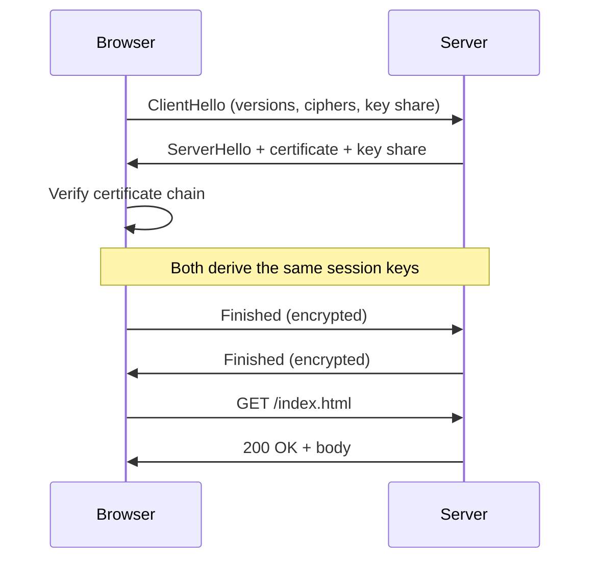

# How does an HTTPS request work?

The browser and server first agree on keys with a TLS handshake, then exchange the
actual HTTP request and response over that encrypted channel.

Notes: this is TLS 1.3 (one round trip). Resumed sessions can skip most of the handshake.
